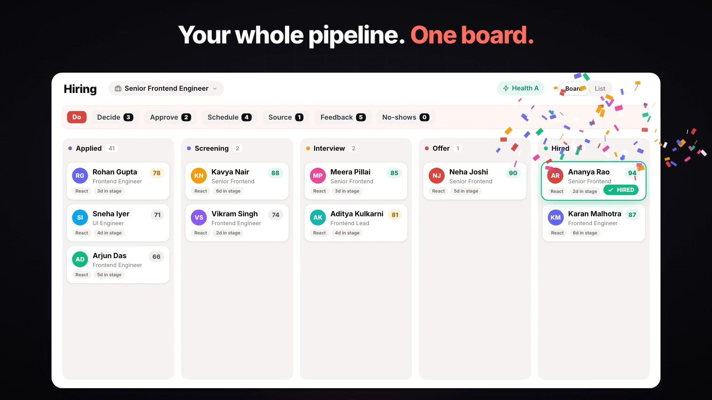
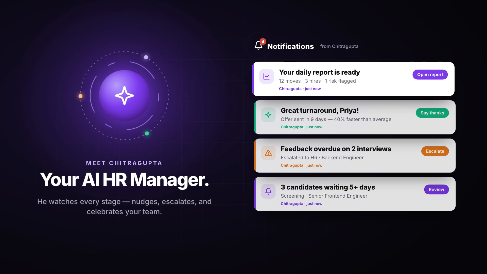
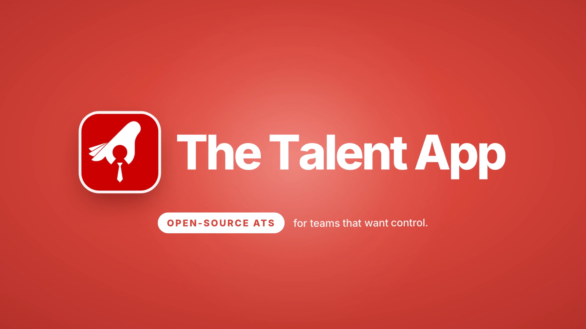

# The Talent App — Open-Source ATS

> Open-source applicant tracking for teams that want control — jobs, pipeline, candidates, interviews, AI scoring, and an installable PWA.

**Self-host:** [docs/LOCAL_SETUP_GUIDE.md](docs/LOCAL_SETUP_GUIDE.md) · [How to self-host an open-source ATS](https://www.thetalentapp.io/self-host-ats/) · [Open-source Greenhouse alternative](https://www.thetalentapp.io/greenhouse-alternative/) · **Website:** [thetalentapp.io](https://www.thetalentapp.io/)

[](docs/readme-assets/the-talent-app-demo.mp4)

▶ [Watch the full 36-second demo (with sound)](docs/readme-assets/the-talent-app-demo.mp4)

| Pipeline board | Chitragupta | Brand |
|:---:|:---:|:---:|
|  |  |  |
| Interview pipeline & hired | AI HR manager | The Talent App |

---

## What is The Talent App?

The Talent App is an open-source ATS that goes beyond tracking — it actively supports the hiring process. Recruiters manage candidates and pipelines; an optional AI agent named **Chitragupta** watches activity, enforces deadlines, escalates issues, and celebrates wins. For enterprise deployments, [SparxIT](https://www.sparxitsolutions.com) offers implementation and managed hosting — [book a demo](https://www.thetalentapp.io/demo/) or see [SUPPORT.md](SUPPORT.md).

### Core Features

| Area | What it does |
|------|-------------|
| **Unified Hiring** | Single `/hiring` workspace — Board (kanban) and List views with a shared job picker; replaces separate Candidates + Pipeline nav |
| **Global Search** | ⌘K command palette — role-scoped lookup for candidates, jobs, and interviews from any page. **Voice input** (mic in the palette) uses the browser Web Speech API — supported in Chrome and Edge on localhost or HTTPS. **Smart search** turns a natural-language sentence into hiring-list filters (name, role, skills, experience, location, stage); not semantic/vector search and not recruiter analytics Q&A |
| **Talent Database** | Full candidate pool with AI-parsed resumes, skill tagging, red flag detection, and credential scoring |
| **Interview Pipeline** | Kanban at `/hiring` with **Do** strip (Decide, Approve, Schedule, Source, Feedback, No-shows), **Radar** FAB (weekly volume/strategy), Health grade chip, drag-and-drop, pinned job tabs, smart stage sorting, stage templates, interview scheduling, structured feedback, work sample uploads, and **Mark as Hired** (`hired_at`) |
| **AI Scoring** | Job fit score (0–100), resume score, red flag analysis — all powered by Gemini; applicant portal ranks open roles with improved deterministic job-match scoring |
| **Pre-Screen & Digital Application** | Question bank (36 questions, 8 categories, 10 random per form), applicant digital application with BGV references, recruiter complete-on-behalf, unified drawer with screening notes |
| **Assessments** | Job-linked assessments with pipeline badges, pass gating, exam consent, tiered AI generation from the Assessments page (6 experience/role profiles), live integrity monitoring (tab-switch counter + warnings), and dynamic portal branding |
| **Evaluations** | Code assessments and custom evaluation forms assigned to candidates; evaluation timeline with integrity events |
| **Email** | Branded transactional email via AWS SES (SMTP) — auth, applicant, and staff flows; **calendar invites (`.ics`)** on interview scheduled emails; nine admin-toggle notification types in Settings → Email; delivery logging. See [docs/EMAIL_NOTIFICATIONS.md](docs/EMAIL_NOTIFICATIONS.md) |
| **Careers & structured data** | Public careers pages with **`JobPosting` JSON-LD** and per-job title/meta (client-rendered; crawlable HTML prerender is a hosting concern) |
| **Enterprise security** | Staff **TOTP MFA** (self-hosted GoTrue — deployer enables TOTP flags), **SAML 2.0 SSO** stub (IdP registration is deployer ops), append-only **audit log** (Settings → Security) |
| **Compliance settings** | Admin-configured privacy/terms URLs, grievance officer, sub-processor disclosure; explicit consent when applicants save sensitive profile fields (DOB, blood group, gender, marital status). Not a GDPR/DPDP certification — see [docs/COMPLIANCE.md](docs/COMPLIANCE.md) |
| **Mobile & PWA** | Mobile-first UI with bottom navigation; installable progressive web app — recruiters and interviewers can review pipelines, submit feedback, and prep for interviews on the go |
| **Calendar** | Unified interview calendar across all jobs with colour-coded event pills |
| **Reports** | Pipeline funnel, recruiter leaderboard, sourcing trends, time-to-hire metrics, AI pipeline health (hire-based conversion; regenerate from health drawer) |
| **Chitragupta** | Autonomous AI HR Manager — monitors every activity, escalates issues, rewards good work, and reports daily to the super admin |
| **Applicant Portal** | Apply from careers page, email-verify redirect, application list, digital forms, job match scores, status tracking, and assessments |
| **Role-based Access** | Admin · HR · Recruiter · Interviewer — HR can access Settings for day-to-day config; each role has scoped access |

---

## Tech Stack

| Layer | Technology |
|-------|-----------|
| Frontend | React 18 + Vite + TypeScript |
| UI Components | Tailwind CSS + shadcn/ui |
| State / Data | TanStack Query v5 |
| Routing | React Router v7 |
| Backend | Supabase (Postgres + Auth + Storage + Realtime) |
| Edge Functions | Deno runtime (Supabase Functions) |
| AI | Google Gemini (`gemini-2.5-flash`) via `GOOGLE_AI_API_KEY` |
| Scheduled Jobs | `pg_cron` (Postgres extension) |

---

## Local Development

### Prerequisites
- Node.js 22 LTS (use [nvm](https://github.com/nvm-sh/nvm))
- A Supabase project (self-hosted or cloud)
- A Google AI API key ([get one here](https://aistudio.google.com/))

### Quick Start

```bash
git clone https://github.com/vikashsparxit/the-talent-app.git
cd the-talent-app
npm install
cp .env.example .env.dev
# Edit .env.dev — see docs/LOCAL_SETUP_GUIDE.md
npm run dev
```

### Environment Variables

Frontend variables (see [.env.example](.env.example)):

```env
VITE_SUPABASE_URL=https://your-project.supabase.co
VITE_SUPABASE_PUBLISHABLE_KEY=your-anon-key
```

Edge functions additionally require (set in Supabase Dashboard → Edge Functions, or via `supabase secrets set`):

```
GOOGLE_AI_API_KEY=your-gemini-key
SUPABASE_URL=...
SUPABASE_SERVICE_ROLE_KEY=...
```

Full setup: [docs/LOCAL_SETUP_GUIDE.md](docs/LOCAL_SETUP_GUIDE.md)

---

## Database Migrations

All schema changes live in `supabase/migrations/` with the naming convention:

```
YYYYMMDDNNNNNN_description.sql
```

**Never run migrations automatically on shared environments.** Always review SQL before applying:

```bash
supabase db push   # applies pending migrations to your linked project
```

New installs start from the single schema baseline (`20261011000000_baseline.sql`); every later migration is applied on top of it. All deployments must apply every migration through the latest one in `supabase/migrations/`.

**Running a 0.x snapshot?** 1.0.0 is a fresh install only, with no in-place upgrade from 0.x. Back up your data and install 1.0.0 fresh; see [docs/UPGRADING.md](docs/UPGRADING.md).

---

## Key Architecture Decisions

- **Gemini-only AI** — all AI features use Google Gemini, called from edge functions. No model API keys reach the browser.
- **Edge Functions are Deno** — import from `https://esm.sh/` or `https://deno.land/std`.
- **RLS on every table** — Row Level Security enforced everywhere. Service role used only inside edge functions.
- **Chitragupta's rules** — the AI HR manager only writes to `notifications` and `chitra_escalations`. It never modifies candidate data or pipeline positions.
- **One super admin** — a single user has `is_super_admin = true` on their profile. This is the principal Chitragupta reports to.

---

## Project Structure

```
src/
├── components/          # Shared UI components
│   ├── candidates/      # Candidate drawer, bulk import, assign dialogs
│   ├── calendar/        # Calendar event pills
│   ├── dashboard/       # Dashboard widgets
│   ├── pipeline/        # Feedback dialog, schedule dialog, stage templates
│   └── ui/              # shadcn/ui base components
├── hooks/               # TanStack Query hooks (data fetching layer)
├── lib/                 # Utilities (cn, formatTz, etc.)
├── pages/               # Route-level page components
└── integrations/        # Supabase client + generated types

supabase/
├── functions/           # Edge functions (Deno)
│   ├── chitra-engine/   # Autonomous HR monitor (hourly cron)
│   ├── chitra-chat/     # Super admin natural language interface
│   ├── analyze-candidate/  # Gemini job-fit + red flag analysis
│   ├── score-pipeline/  # Gemini pipeline health scorer
│   └── ...
└── migrations/          # All DB migrations (numbered, reviewed before apply)
```

---

## User Roles

| Role | Access |
|------|--------|
| `admin` | Full access to everything |
| `hr` | Manage candidates, all jobs, HR escalations |
| `recruiter` | Full candidate database (view, add, update); job assignments drive ownership and attribution, not visibility |
| `interviewer` | Assigned candidates, submit feedback |

There is one **Super Admin** (`is_super_admin = true`) who sits above all roles and is Chitragupta's principal.

---

## Deployment

Build the static frontend and deploy `dist/` to your host (CDN, object storage, or reverse proxy). Edge functions deploy to your Supabase project.

```bash
npm test
npm run build
```

Hosting is environment-specific — see [docs/LOCAL_SETUP_GUIDE.md](docs/LOCAL_SETUP_GUIDE.md) for self-hosted Supabase.

---

## Need help?

- **Self-host:** [docs/LOCAL_SETUP_GUIDE.md](docs/LOCAL_SETUP_GUIDE.md) · [Self-host guide (web)](https://www.thetalentapp.io/self-host-ats/) · [SUPPORT.md](SUPPORT.md)
- **Product overview:** [thetalentapp.io](https://www.thetalentapp.io/)
- **Production demo / custom deploy:** [Book a demo](https://www.thetalentapp.io/demo/)

### Guides (website)

| Guide | Link |
|-------|------|
| What is an open-source ATS? | [thetalentapp.io/open-source-ats](https://www.thetalentapp.io/open-source-ats/) |
| How to self-host an ATS | [thetalentapp.io/self-host-ats](https://www.thetalentapp.io/self-host-ats/) |
| Greenhouse alternative | [thetalentapp.io/greenhouse-alternative](https://www.thetalentapp.io/greenhouse-alternative/) |
| How it works | [thetalentapp.io/how-it-works](https://www.thetalentapp.io/how-it-works/) |

---

## Contributing & License

- [SUPPORT.md](SUPPORT.md) — self-host, community, and professional services
- [CHANGELOG.md](CHANGELOG.md) — release history
- [docs/UPGRADING.md](docs/UPGRADING.md) — upgrade notes between releases (1.0.0 is fresh install only)
- [CODE_OF_CONDUCT.md](CODE_OF_CONDUCT.md) · [GOVERNANCE.md](GOVERNANCE.md) · [MAINTAINERS.md](MAINTAINERS.md)
- [CONTRIBUTING.md](CONTRIBUTING.md) — how to report issues and send pull requests
- [SECURITY.md](SECURITY.md) — responsible disclosure
- [LICENSE](LICENSE) — MIT
- [AI_FEATURES.md](AI_FEATURES.md) — AI capability reference
- [docs/AI_PROMPTS.md](docs/AI_PROMPTS.md) — engineer prompt inventory (edge functions)
- [docs/EMAIL_NOTIFICATIONS.md](docs/EMAIL_NOTIFICATIONS.md) — scoped email types and admin toggles
- [docs/guides/oss-self-host.md](docs/guides/oss-self-host.md) — self-host quickstart

---

*Built and maintained by [SparxIT](https://www.sparxitsolutions.com).*
